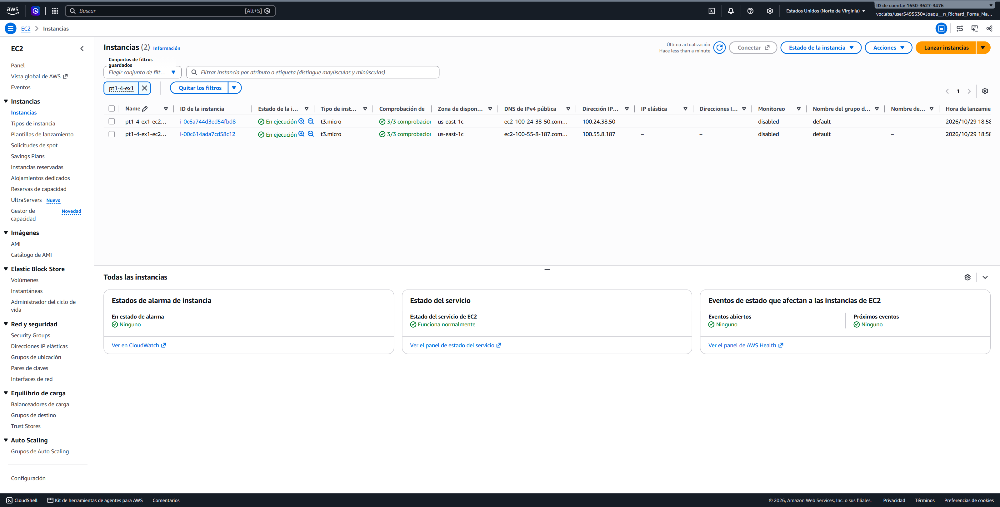
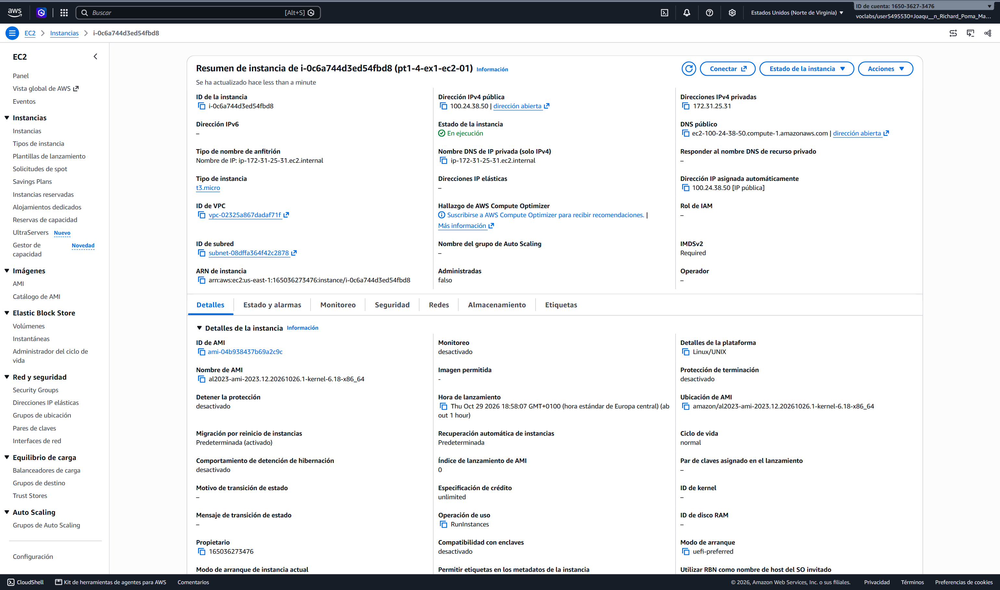
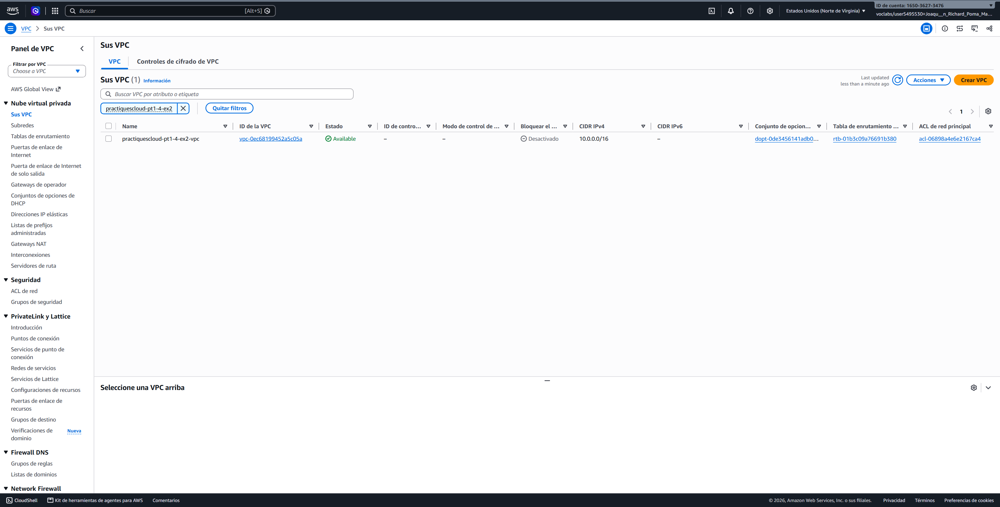
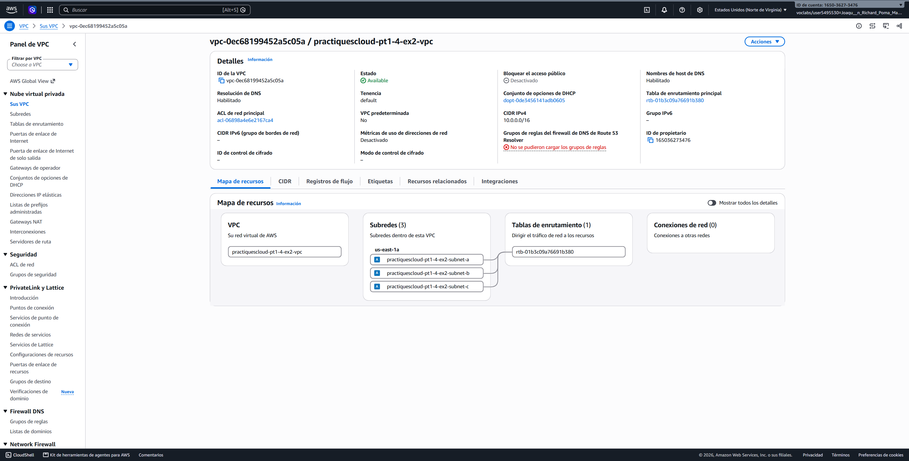
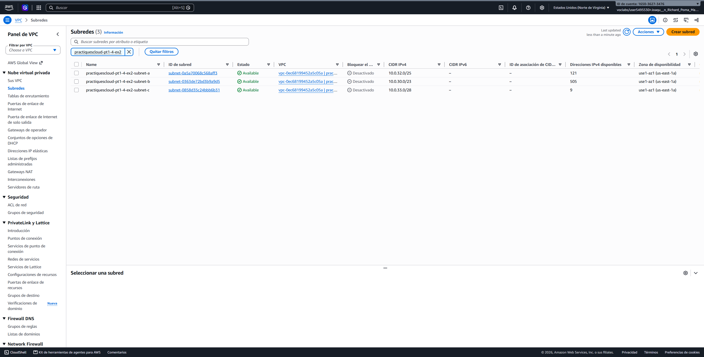
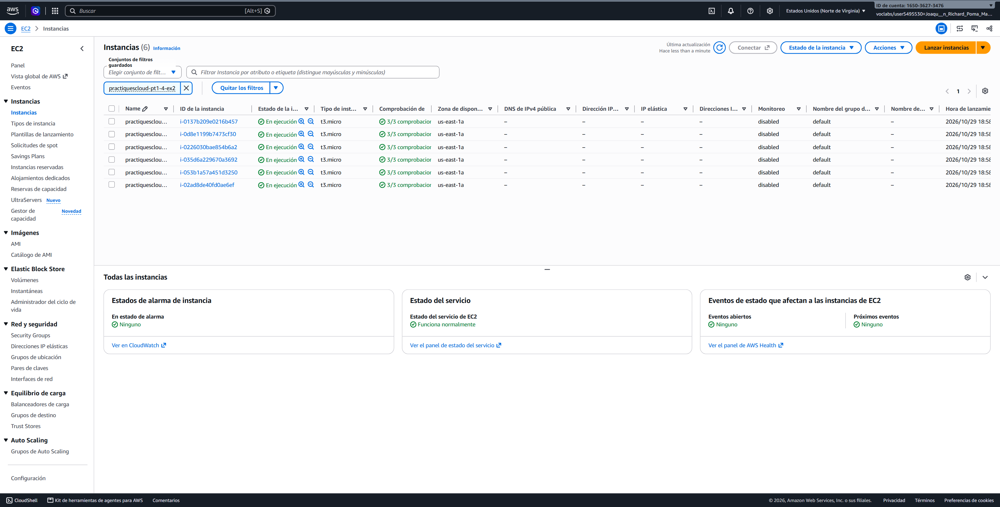
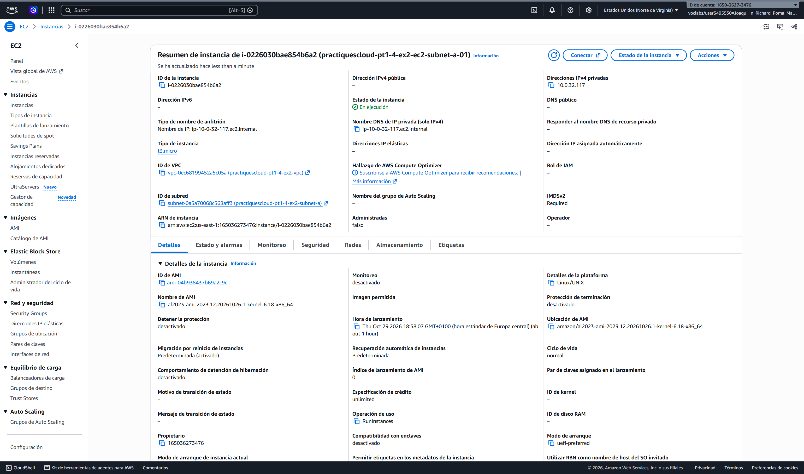

# Guía paso a paso — Práctica Pt1.4 (Cloud Computing)

> Documento de apoyo en castellano. La documentación oficial de cada ejercicio está en catalán dentro de `pt1-4-ex1/README.md` y `pt1-4-ex2/README.md`.

## 0. Requisitos previos

- Terraform `>= 1.5.0` (`terraform version`).
- AWS CLI v2 (`aws --version`).
- Cuenta de **AWS Academy Learner Lab** iniciada.
- Credenciales temporales en `~/.aws/credentials`:

```ini
[default]
aws_access_key_id = ASIA...
aws_secret_access_key = ...
aws_session_token = ...
```

Comprobar que las credenciales funcionan:

```bash
aws sts get-caller-identity
```

Debe devolver el `Account` y el `Arn` de la cuenta del laboratorio. Si aparece `ExpiredToken`, vuelve a copiar las credenciales desde **AWS Details → AWS CLI → Show**.

---

## 1. Ejercicio 1 — 2 instancias EC2 con Terraform

**Objetivo:** crear 2 instancias `t3.micro` con Amazon Linux 2023 en `us-east-1` usando Terraform.

### 1.1. Estructura

```text
pt1-4-ex1/
├── assets/
│   ├── topologia.drawio
│   ├── topologia.png
│   ├── aws_ec2_instances.png
│   └── aws_instance_details.png
├── README.md
└── main.tf
```

### 1.2. Qué hace el código

- `data "aws_ami"` obtiene siempre la AMI más reciente de Amazon Linux 2023.
- `aws_instance` con `for_each` crea una instancia por cada nombre de `var.instance_names`.
- `default_tags` etiqueta todos los recursos (`Project`, `Environment`, `Exercise`, `ManagedBy`).

### 1.3. Ejecución

```bash
cd pt1-4-ex1
terraform init
terraform fmt
terraform validate
terraform plan
terraform apply
```

Escribe `yes` cuando `apply` pida confirmación. El plan debe indicar **2 recursos a crear**.

### 1.4. Verificación

```bash
aws ec2 describe-instances \
  --filters "Name=tag:Project,Values=practiquescloud-pt1-4-ex1" \
  --query "Reservations[].Instances[].{Nombre:Tags[?Key=='Name'].Value|[0],Estado:State.Name,Tipo:InstanceType,IP:PublicIpAddress}" \
  --output table
```

Captura real de la consola (**EC2 → Instancias**, filtro `pt1-4-ex1`): se ven las 2 instancias en estado `running`, tipo `t3.micro`, zona `us-east-1c`.



Detalle de una instancia (nombre completo, IP privada, AMI y tipo):



### 1.5. Destruir

```bash
terraform destroy
```

---

## 2. Ejercicio 2 — VPC, subredes y 6 instancias EC2

**Objetivo:** crear una VPC `10.0.0.0/16`, 3 subredes en `us-east-1a` y 2 instancias `t3.micro` por subred (6 en total). Se hace primero por consola (Parte B) y después con Terraform (Parte C).

### 2.1. Direccionamiento

| Subred | CIDR | Máscara | Rango de hosts | Broadcast | IPs útiles | IPs disponibles en AWS |
|---|---|---|---|---|---|---|
| **A** | `10.0.32.0/25` | `255.255.255.128` | `10.0.32.1 – 10.0.32.126` | `10.0.32.127` | 126 | **121** |
| **B** | `10.0.30.0/23` | `255.255.254.0` | `10.0.30.1 – 10.0.31.254` | `10.0.31.255` | 510 | **505** |
| **C** | `10.0.33.0/28` | `255.255.255.240` | `10.0.33.1 – 10.0.33.14` | `10.0.33.15` | 14 | **9** |

AWS reserva 5 direcciones por subred (red, router de la VPC, DNS, uso futuro y broadcast).

### 2.2. Parte B — Despliegue por consola (GUI)

1. Entra en **VPC → Your VPCs → Create VPC** y crea la VPC `practiquescloud-pt1-4-ex2-vpc` con CIDR `10.0.0.0/16`.
2. En **Subnets → Create subnet**, crea las 3 subredes en `us-east-1a` con los CIDR de la tabla. Desactiva la asignación automática de IP pública.
3. En **EC2 → Launch instances**, crea 6 instancias `t3.micro` con Amazon Linux 2023, 2 en cada subred, con nombres `...-ec2-subnet-a-01`, `...-a-02`, `...-b-01`, `...-b-02`, `...-c-01`, `...-c-02`.
4. Haz las capturas de la VPC, las subredes y el listado de las 6 instancias.

> Las subredes son privadas: no se crea Internet Gateway ni NAT Gateway, porque el enunciado no lo pide.

### 2.3. Parte C — Despliegue con Terraform

```bash
cd pt1-4-ex2
terraform init
terraform fmt
terraform validate
terraform plan
terraform apply
```

El plan debe indicar **1 VPC + 3 subredes + 6 instancias**. Consulta los resultados:

```bash
terraform output
terraform output -json instance_summary
```

Ejemplo de salida real de este despliegue:

```text
vpc_id = "vpc-0ec68199452a5c05a"
subnet_ids = {
  "a" = "subnet-0a5a70068c568aff3"
  "b" = "subnet-0363de72bd3b9a9d5"
  "c" = "subnet-0858d35c24bbb6b31"
}
instance_private_ips = {
  "a-01" = "10.0.32.117"
  "a-02" = "10.0.32.9"
  "b-01" = "10.0.31.71"
  "b-02" = "10.0.30.37"
  "c-01" = "10.0.33.6"
  "c-02" = "10.0.33.9"
}
```

### 2.4. Verificación con capturas reales

**VPC creada (10.0.0.0/16):**



**Detalle de la VPC y mapa de recursos (3 subredes en us-east-1a):**



**Las 3 subredes con sus CIDR y la zona `us-east-1a`:**



**Las 6 instancias EC2 en ejecución:**



**Detalle de una instancia (nombre completo, IP privada, VPC y subred):**



### 2.5. Destruir

```bash
cd pt1-4-ex2
terraform destroy
```

Si hiciste también la Parte B por consola, bórrala a mano en orden inverso: instancias → subredes → VPC.

---

## 3. Checklist de la rúbrica

- [x] Código Terraform limpio, con variables y `for_each` (35 %).
- [x] VPC `10.0.0.0/16`, 3 subredes con los CIDR exactos y 6 instancias en `us-east-1a` (20 %).
- [x] Diagramas de topología en `.drawio` y `.png` con iconos de AWS (15 %).
- [x] Estructura de carpetas `pt1-4-ex1/` y `pt1-4-ex2/` con `assets/` y `README.md` (15 %).
- [x] README con pasos, instrucciones de ejecución y capturas reales de la consola (15 %).

---

## 4. Publicación en GitHub

Repositorio **público** ya publicado:

**https://github.com/joaquinking12/practiquescloud**

Si necesitas volver a subir cambios:

```bash
cd practiquescloud
git add -A
git commit -m "Descripció del canvi"
git push
```

> El repositorio debe ser **público** y llamarse `practiquescloud`, tal como pide el enunciado. `terraform.tfstate` y la carpeta `.terraform/` no se suben (están en `.gitignore`).
