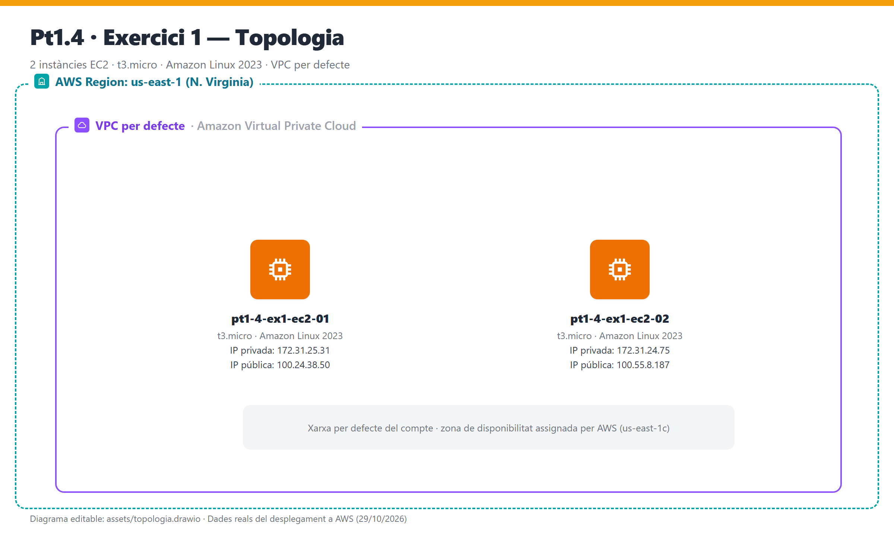
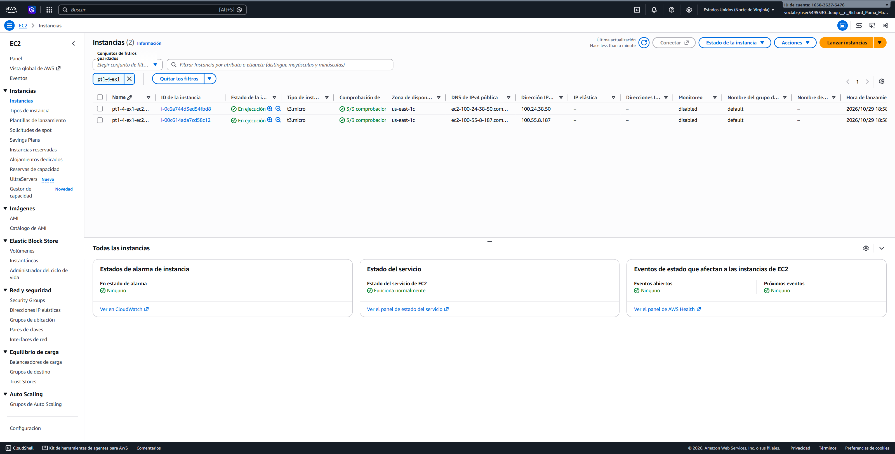
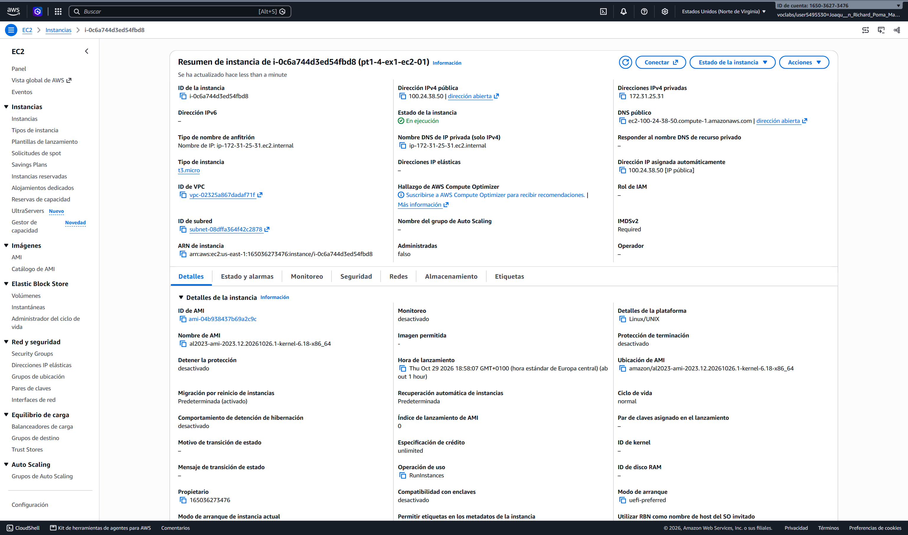

# Pt1.4 · Exercici 1 — Primeres instàncies EC2 amb Terraform

## Descripció

Aquest projecte és una introducció a la **Infraestructura com a Codi (IaC)** amb Terraform. L'objectiu és desplegar de forma automàtica **2 instàncies EC2** amb **Amazon Linux 2023** i tipus **t3.micro** a la regió **us-east-1**, dins la **VPC per defecte** del compte d'AWS Academy Learner Lab.

No es crea cap VPC ni subxarxa: les instàncies s'ubiquen a la xarxa que AWS proporciona per defecte al compte. L'AMI no està fixada al codi; s'obté amb un `data source` que selecciona sempre la versió més recent d'Amazon Linux 2023.

## Objectius

- Entendre l'estructura bàsica d'un projecte Terraform.
- Configurar el provider d'AWS sense incrustar credencials.
- Obtenir una AMI dinàmicament mitjançant `data "aws_ami"`.
- Crear diverses instàncies amb un bucle `for_each`.
- Etiquetar correctament tots els recursos.

## Arquitectura desplegada

| Recurs | Configuració |
|---|---|
| Regió | `us-east-1` (N. Virginia) |
| Nombre d'instàncies | 2 |
| Tipus d'instància | `t3.micro` |
| Sistemes operatius | Amazon Linux 2023 (x86_64) |
| AMI | Obtinguda amb `data "aws_ami"` (`most_recent = true`) |
| Xarxa | VPC per defecte del compte |
| Etiquetes | `Name`, `Project`, `Environment`, `Exercise`, `ManagedBy` |

### Topologia



> El diagrama editable amb icones oficials d'AWS és al fitxer [`assets/topologia.drawio`](assets/topologia.drawio). Es pot obrir amb draw.io o amb [app.diagrams.net](https://app.diagrams.net).

## Estructura del projecte

```text
pt1-4-ex1/
├── assets/
│   ├── topologia.drawio
│   ├── topologia.png
│   ├── aws_ec2_instances.png
│   └── aws_instance_details.png
├── README.md
└── main.tf
```

## Requisits previs

- Terraform `>= 1.5.0`.
- Un compte d'AWS Academy Learner Lab actiu.
- Les credencials temporals del laboratori desades a `~/.aws/credentials`.
- Opcionalment, AWS CLI v2 per comprovar els recursos des de la terminal.

## Configuració de les credencials

AWS Academy genera credencials temporals que inclouen un **session token**. Al Learner Lab, fes clic a **AWS Details → AWS CLI → Show** i copia els tres valors.

El fitxer `~/.aws/credentials` ha de tenir aquest format:

```ini
[default]
aws_access_key_id = ASIA...
aws_secret_access_key = ...
aws_session_token = ...
```

El provider no conté cap credencial: utilitza la cadena de credencials per defecte del SDK d'AWS, que llegeix aquest fitxer automàticament.

> **Important:** les credencials caduquen quan el laboratori s'atura o es reinicia. Si Terraform retorna `ExpiredToken` o `InvalidClientTokenId`, torna a copiar-les.

## Procediment pas a pas

1. **Activar el laboratori:** entra a AWS Academy, obre el Learner Lab i fes clic a **Start Lab**.
2. **Copiar les credencials:** a **AWS Details → AWS CLI → Show**, copia l'access key, la secret key i el session token.
3. **Desar-les:** enganxa els tres valors a `~/.aws/credentials`, sota el perfil `[default]`.
4. **Inicialitzar Terraform:** executa `terraform init` per descarregar el provider d'AWS.
5. **Formatejar i validar:** executa `terraform fmt` i `terraform validate` per comprovar la sintaxi.
6. **Revisar el pla:** executa `terraform plan`; hi ha d'haver **2 recursos a crear** (`aws_instance.this`).
7. **Aplicar:** executa `terraform apply` i confirma amb `yes`.
8. **Verificar:** comprova a **EC2 → Instances** que les dues instàncies estan en estat **Running**.
9. **Netejar:** quan acabis, executa `terraform destroy` i confirma amb `yes`.

## Explicació del codi (`main.tf`)

1. **Bloc `terraform`**: defineix la versió mínima de Terraform i el provider `hashicorp/aws` (`~> 6.0`).
2. **`provider "aws"`**: fixa la regió mitjançant la variable `aws_region` i aplica les etiquetes comunes amb `default_tags`.
3. **Variables**: tots els valors configurables (regió, tipus d'instància, noms, patró de l'AMI) són variables, no valors hardcodejats dins dels recursos.
4. **`data "aws_ami"`**: cerca l'AMI més recent d'Amazon Linux 2023 propietat d'Amazon, filtrant per nom, arquitectura `x86_64` i virtualització `hvm`.
5. **`aws_instance` amb `for_each`**: recorre el conjunt `var.instance_names` i crea una instància per cada nom. L'etiqueta `Name` pren el valor de cada element.
6. **Etiquetes**: `default_tags` aporta `Project`, `Environment`, `Exercise` i `ManagedBy`; cada recurs afegeix la seva `Name` descriptiva.

## Execució

Des de la carpeta `pt1-4-ex1`:

```bash
terraform init
terraform fmt
terraform validate
terraform plan
terraform apply
```

`terraform apply` demanarà confirmació; escriu `yes` per crear les 2 instàncies.

### Comprovar el resultat

Al núvol:

```bash
aws ec2 describe-instances \
  --filters "Name=tag:Project,Values=practiquescloud-pt1-4-ex1" \
  --query "Reservations[].Instances[].{Nom:Tags[?Key=='Name'].Value|[0],Estat:State.Name,Tipus:InstanceType,AMI:ImageId}" \
  --output table
```

També pots consultar-les a la consola d'AWS: **EC2 → Instances**.

## Captures reals del desplegament

Les captures següents s'han obtingut directament de la consola d'AWS (regió **us-east-1**) un cop executat `terraform apply`. Es pot veure el filtre `pt1-4-ex1`, les **2 instàncies en estat `running`**, el tipus `t3.micro` i la zona `us-east-1c`.

### Llistat de les 2 instàncies EC2



### Detall d'una instància



## Variables

| Variable | Valor per defecte | Descripció |
|---|---|---|
| `aws_region` | `us-east-1` | Regió on es despleguen els recursos |
| `project_name` | `practiquescloud-pt1-4-ex1` | Nom del projecte per a les etiquetes |
| `environment` | `formacio` | Entorn de desplegament |
| `instance_type` | `t3.micro` | Tipus d'instància EC2 |
| `instance_names` | `["pt1-4-ex1-ec2-01", "pt1-4-ex1-ec2-02"]` | Noms de les instàncies |
| `ami_name_pattern` | `al2023-ami-2023.*-x86_64` | Patró de cerca de l'AMI |

## Neteja dels recursos

Quan ja no calguin les instàncies:

```bash
terraform destroy
```

Aquest comandament elimina les 2 instàncies EC2 creades per aquest projecte. No afecta la VPC per defecte ni cap altre recurs del compte.

## Exportar el diagrama a PNG

1. Obre `assets/topologia.drawio` amb draw.io Desktop o amb [app.diagrams.net](https://app.diagrams.net).
2. Ves a **File → Export as → PNG**.
3. Selecciona una escala del 200 % per obtenir una imatge nítida.
4. Desa el fitxer com a `assets/topologia.png`.

## Solució de problemes

| Error | Causa i solució |
|---|---|
| `InvalidClientTokenId` / `ExpiredToken` | Les credencials del Learner Lab han caducat. Torna a copiar-les a `~/.aws/credentials`. |
| `No valid credential sources found` | No existeix `~/.aws/credentials` o el perfil `default` no és correcte. |
| L'AMI no es troba | Comprova que el patró `al2023-ami-2023.*-x86_64` continuï sent vàlid a la regió. |
| `terraform plan` proposa reemplaçar les instàncies | És normal: `data "aws_ami"` amb `most_recent = true` detecta una AMI nova. Si vols conservar les instàncies actuals, fixa l'AMI amb un ID concret. |
