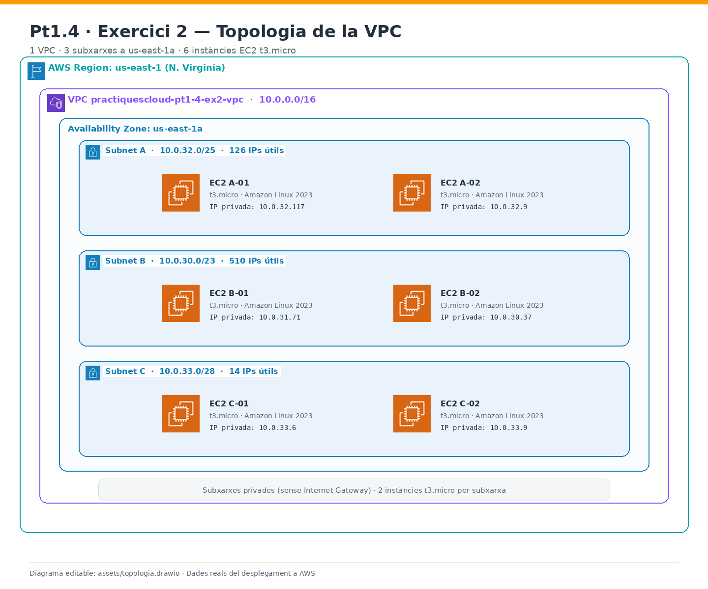
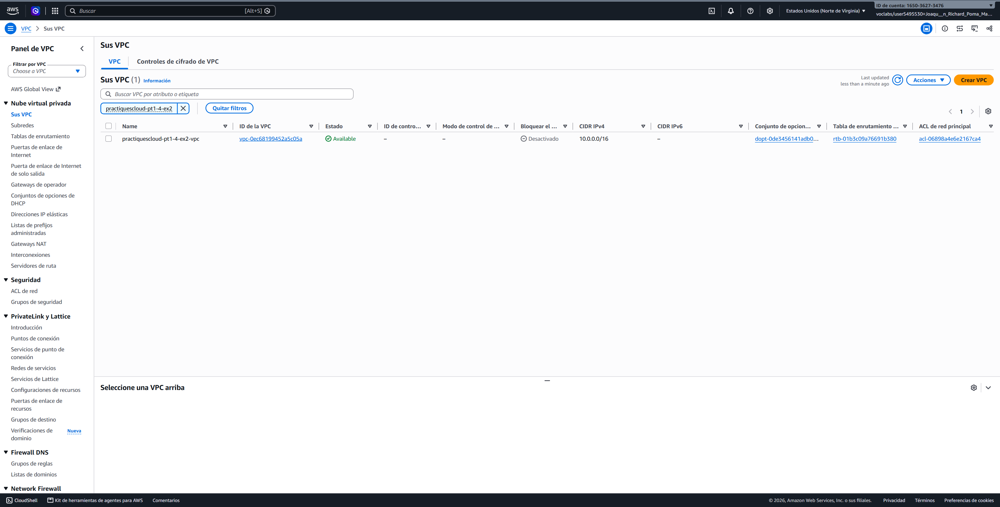
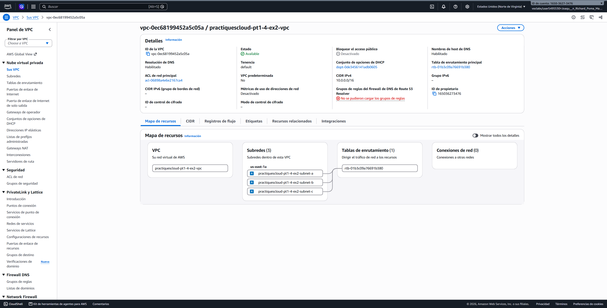
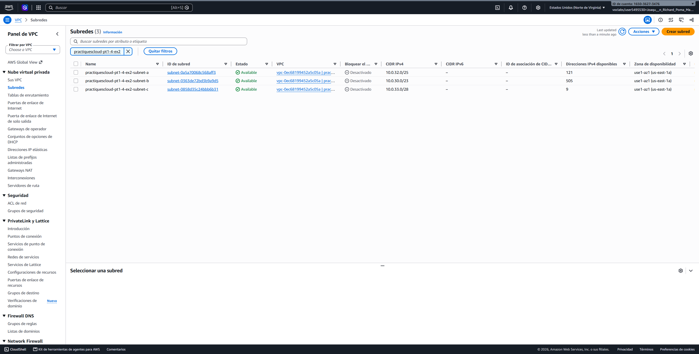
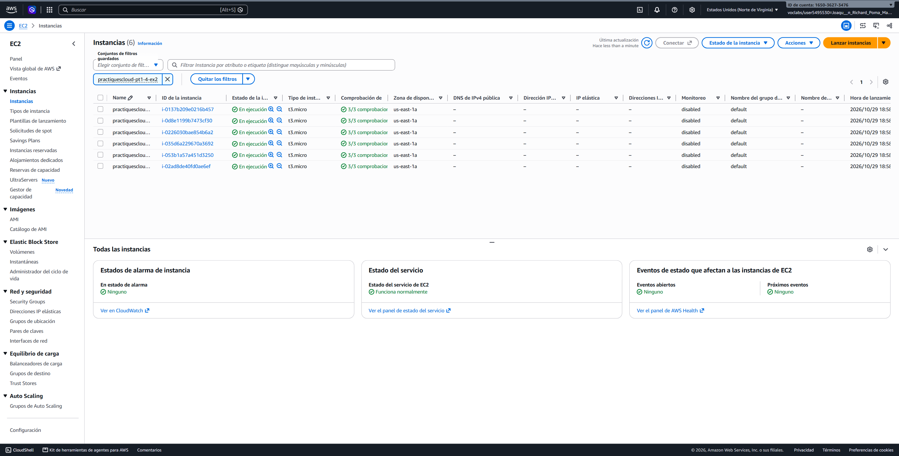
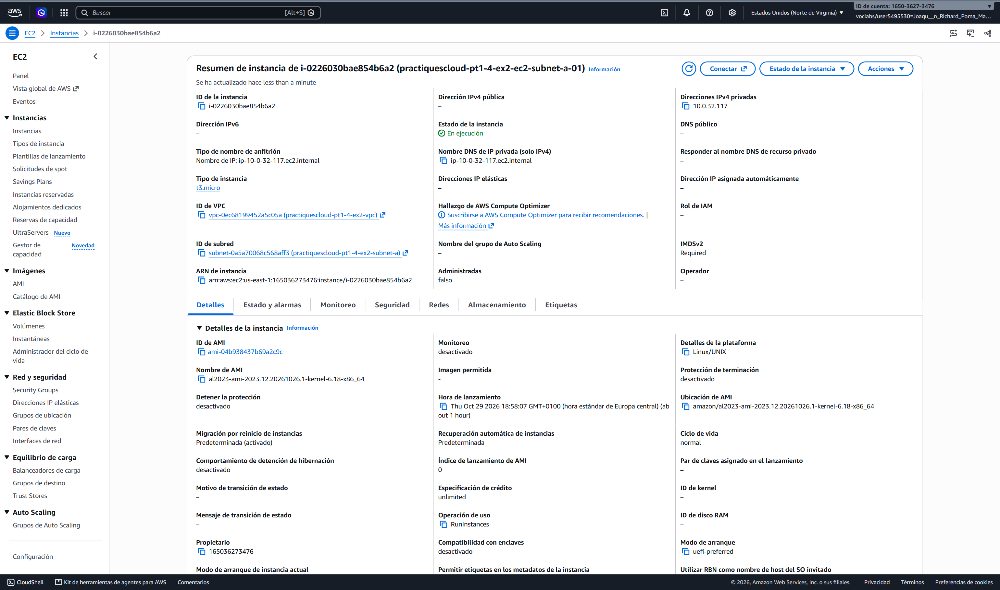

# Pt1.4 · Exercici 2 — VPC, subxarxes i EC2 (consola + Terraform)

## Descripció

Aquest projecte desplega una xarxa completa a AWS i compara les dues formes de treballar-hi:

- **Part A — Disseny de xarxa:** una VPC `10.0.0.0/16` amb tres subxarxes a la mateixa zona de disponibilitat (`us-east-1a`).
- **Part B — Desplegament manual:** creació de tota la infraestructura des de la consola d'AWS, amb captures de pantalla.
- **Part C — Desplegament amb Terraform (IaC):** automatització de la VPC, les tres subxarxes i les sis instàncies EC2.

Cada subxarxa allotja **2 instàncies EC2 `t3.micro` amb Amazon Linux 2023**, és a dir, **6 instàncies en total**. Totes les subxarxes són privades: no es crea Internet Gateway ni NAT Gateway, perquè l'enunciat no ho requereix i no són necessaris per a l'exercici.

## Objectius

- Interpretar i calcular adreçament IPv4 (CIDR, màscara, xarxa, broadcast i hosts).
- Crear una VPC i diverses subxarxes a AWS.
- Comparar el desplegament manual (GUI) amb el desplegament automatitzat (Terraform).
- Utilitzar bucles i mapes per crear recursos repetitius sense duplicar codi.
- Exposar informació útil mitjançant `outputs`.

## Arquitectura

| Recurs | Configuració |
|---|---|
| Regió | `us-east-1` |
| VPC | `10.0.0.0/16` |
| Zona de disponibilitat | `us-east-1a` (totes les subxarxes) |
| Subnet A | `10.0.32.0/25` |
| Subnet B | `10.0.30.0/23` |
| Subnet C | `10.0.33.0/28` |
| Instàncies | 2 per subxarxa (6 en total) |
| Tipus | `t3.micro` |
| Sistema operatiu | Amazon Linux 2023 (x86_64) |
| AMI | `data "aws_ami"` amb `most_recent = true` |
| Connectivitat | Subxarxes privades, sense Internet Gateway |

### Topologia



> El diagrama editable amb icones oficials d'AWS és al fitxer [`assets/topologia.drawio`](assets/topologia.drawio).

## Part A — Disseny de xarxa

### Taula d'adreçament

| Subnet | CIDR | Adreça de xarxa | Màscara | Rang de hosts | Broadcast | IPs utilitzables | Capacitat |
|---|---|---|---|---|---|---|---|
| **A** | `10.0.32.0/25` | `10.0.32.0` | `255.255.255.128` | `10.0.32.1 – 10.0.32.126` | `10.0.32.127` | 126 | 128 adreces |
| **B** | `10.0.30.0/23` | `10.0.30.0` | `255.255.254.0` | `10.0.30.1 – 10.0.31.254` | `10.0.31.255` | 510 | 512 adreces |
| **C** | `10.0.33.0/28` | `10.0.33.0` | `255.255.255.240` | `10.0.33.1 – 10.0.33.14` | `10.0.33.15` | 14 | 16 adreces |

> **Nota:** AWS reserva 5 adreces a cada subxarxa (adreça de xarxa, router de la VPC, DNS, ús futur i broadcast). Per tant, la capacitat real per a instàncies és de **121** a la Subnet A, **505** a la Subnet B i **9** a la Subnet C. Amb 2 instàncies per subxarxa hi ha marge suficient.

### Càlcul de cada subxarxa

- **Subnet A (`/25`):** la màscara deixa 7 bits per als hosts (`2^7 = 128` adreces). El bloc va de `10.0.32.0` a `10.0.32.127`; la primera adreça és la xarxa i la darrera el broadcast.
- **Subnet B (`/23`):** la màscara deixa 9 bits per als hosts (`2^9 = 512` adreces). El bloc ocupa `10.0.30.0 – 10.0.31.255`; el broadcast és `10.0.31.255`.
- **Subnet C (`/28`):** la màscara deixa 4 bits per als hosts (`2^4 = 16` adreces). El bloc va de `10.0.33.0` a `10.0.33.15`; el broadcast és `10.0.33.15`.

Les tres subxarxes estan dins de `10.0.0.0/16` i **no se solapen** entre elles.

### Per què totes a `us-east-1a`?

L'enunciat demana expressament que les tres subxarxes estiguin associades a la mateixa zona de disponibilitat. Això simplifica el disseny, però **no aporta alta disponibilitat**: si `us-east-1a` falla, tota la infraestructura queda afectada. Un disseny de producció distribuït hauria de repartir les subxarxes entre diverses AZ.

## Part B — Desplegament manual per consola

Aquesta part es fa íntegrament des de la consola web d'AWS, sense Terraform. Serveix per comprendre quins passos automatitza el codi de la Part C.

### 1. Preparar el laboratori

1. Entra a **AWS Academy** i obre el curs del mòdul.
2. Fes clic a **Modules → Learner Lab** i després a **Start Lab**.
3. Espera que el punt del costat de **AWS** es posi verd i fes clic a **AWS** per obrir la consola.
4. Comprova que la regió seleccionada a la part superior dreta és **US East (N. Virginia) — us-east-1**.

### 2. Crear la VPC

1. A la barra de cerca, escriu **VPC** i obre el servei.
2. Ves a **Your VPCs → Create VPC**.
3. Selecciona **VPC only**.
4. **Name tag:** `practiquescloud-pt1-4-ex2-vpc`.
5. **IPv4 CIDR block:** `10.0.0.0/16`.
6. Deixa **Tenancy** en `Default` i fes clic a **Create VPC**.

### 3. Crear les tres subxarxes

1. Ves a **Subnets → Create subnet**.
2. Selecciona la VPC creada (`practiquescloud-pt1-4-ex2-vpc`).
3. Crea la **Subnet A**:
   - **Subnet name:** `practiquescloud-pt1-4-ex2-subnet-a`
   - **Availability Zone:** `us-east-1a`
   - **IPv4 CIDR block:** `10.0.32.0/25`
4. Repeteix el procés per a la **Subnet B**:
   - **Subnet name:** `practiquescloud-pt1-4-ex2-subnet-b`
   - **Availability Zone:** `us-east-1a`
   - **IPv4 CIDR block:** `10.0.30.0/23`
5. Repeteix el procés per a la **Subnet C**:
   - **Subnet name:** `practiquescloud-pt1-4-ex2-subnet-c`
   - **Availability Zone:** `us-east-1a`
   - **IPv4 CIDR block:** `10.0.33.0/28`
6. Per a cada subxarxa, desactiva l'assignació automàtica d'IP pública:
   - Selecciona la subxarxa → **Actions → Edit subnet settings**.
   - Desmarca **Enable auto-assign public IPv4 address** → **Save**.

> No cal crear Internet Gateway, taules de rutes personalitzades ni NAT Gateway. Les instàncies quedaran en subxarxes privades, sense sortida directa a Internet.

### 4. (Opcional) Crear un grup de seguretat

Si vols poder connectar-te per SSH més endavant:

1. Ves a **Security Groups → Create security group**.
2. **Name:** `practiquescloud-pt1-4-ex2-sg`.
3. **VPC:** la VPC creada.
4. Afegeix una regla **Inbound → SSH (22)** amb origen **My IP**.
5. Deixa la regla **Outbound** per defecte.

Si no necessites SSH, pots utilitzar el grup de seguretat `default` de la VPC.

### 5. Llançar les sis instàncies EC2

Per a cada una de les sis instàncies (2 per subxarxa):

1. Ves a **EC2 → Instances → Launch instances**.
2. **Name:** per exemple `practiquescloud-pt1-4-ex2-ec2-subnet-a-01`.
3. **Application and OS Images:** tria **Amazon Linux 2023** (AMI x86_64).
4. **Instance type:** `t3.micro`.
5. **Key pair:** selecciona'n un si necessites SSH; si no, pots continuar sense.
6. **Network settings → Edit**:
   - **VPC:** `practiquescloud-pt1-4-ex2-vpc`.
   - **Subnet:** la subxarxa corresponent (A, B o C).
   - **Auto-assign public IP:** `Disable`.
   - **Security group:** el creat a l'apartat anterior o `default`.
7. Deixa l'emmagatzematge per defecte i fes clic a **Launch instance**.
8. Repeteix fins a tenir **2 instàncies a cada subxarxa** (6 en total), amb noms descriptius:
   - `...-ec2-subnet-a-01`, `...-ec2-subnet-a-02`
   - `...-ec2-subnet-b-01`, `...-ec2-subnet-b-02`
   - `...-ec2-subnet-c-01`, `...-ec2-subnet-c-02`

### 6. Verificar i fer les captures

1. **VPC → Subnets:** filtra per la VPC creada. Hi ha d'haver les 3 subxarxes amb els CIDR correctes i l'AZ `us-east-1a`.
   - Fes una captura i desa-la com a `assets/vpc_subnets.png`.
2. **EC2 → Instances:** filtra per la VPC creada. Hi ha d'haver les 6 instàncies en estat **Running**.
   - Fes una captura i desa-la com a `assets/ec2_instances.png`.

### Captures del desplegament

Totes les captures següents són **captures reals de la consola d'AWS** (regió `us-east-1`, 29/10/2026), fetes després del desplegament. S'hi poden veure els identificadors reals dels recursos, els CIDR i la zona de disponibilitat.

#### 1. VPC creada (`10.0.0.0/16`)



#### 2. Detall de la VPC i mapa de recursos



#### 3. Les 3 subxarxes a `us-east-1a`

A la captura es veuen els CIDR `10.0.32.0/25`, `10.0.30.0/23` i `10.0.33.0/28`, la zona `us-east-1a` i les IPs disponibles (121, 505 i 9 respectivament).



#### 4. Les 6 instàncies EC2 en execució



#### 5. Detall d'una instància

S'hi pot comprovar el nom complet, la IP privada, la VPC, la subxarxa, la zona de disponibilitat, el tipus `t3.micro` i l'AMI d'Amazon Linux 2023.



## Part C — Desplegament amb Terraform

### Estructura del projecte

```text
pt1-4-ex2/
├── assets/
│   ├── topologia.drawio
│   ├── topologia.png
│   ├── aws_vpc_list.png
│   ├── aws_vpc_details.png
│   ├── vpc_subnets.png
│   ├── ec2_instances.png
│   └── aws_instance_details.png
├── README.md
├── main.tf
├── variables.tf
└── outputs.tf
```

### Explicació del codi

- **`variables.tf`**
  - `vpc_cidr` i el mapa `subnets` contenen tot l'adreçament. Els CIDR no estan hardcodejats dins dels recursos.
  - `availability_zone` fixa `us-east-1a` per a totes les subxarxes.
  - `instances_per_subnet` defineix quantes instàncies es creen a cada subxarxa (2 per defecte).
  - Hi ha validacions per comprovar que els CIDR siguin vàlids i que el nombre d'instàncies estigui entre 1 i 10.
- **`main.tf`**
  - `provider "aws"` llegeix la regió de les variables i aplica etiquetes comunes amb `default_tags`.
  - `data "aws_ami"` selecciona la imatge més recent d'Amazon Linux 2023 sense cap ID fix.
  - `aws_vpc` crea la VPC `10.0.0.0/16` amb DNS habilitat.
  - `aws_subnet` recorre `var.subnets` amb `for_each`; totes les subxarxes hereten la mateixa AZ i tenen l'IP pública desactivada.
  - `locals.instances` genera, amb bucles `for` i `flatten`, un mapa de 6 entrades (2 per subxarxa).
  - `aws_instance` recorre aquest mapa amb `for_each` i assigna cada instància a la subxarxa corresponent.
- **`outputs.tf`**
  - Retorna l'ID de la VPC, els IDs i CIDR de les subxarxes, i els IDs i IPs privades de les instàncies.

L'ús de `for_each` (en lloc de duplicar blocs) fa que afegir una subxarxa o una instància sigui tan simple com modificar una variable.

### Recursos que es creen

| Recurs | Nombre | Nom |
|---|---|---|
| VPC | 1 | `practiquescloud-pt1-4-ex2-vpc` |
| Subxarxes | 3 | `...-subnet-a`, `...-subnet-b`, `...-subnet-c` |
| Instàncies EC2 | 6 | `...-ec2-subnet-a-01` … `...-ec2-subnet-c-02` |

Tots els recursos porten l'etiqueta `Name`, a més de `Project`, `Environment`, `Exercise` i `ManagedBy`.

## Requisits previs

- Terraform `>= 1.5.0`.
- Compte d'AWS Academy Learner Lab actiu.
- Credencials temporals a `~/.aws/credentials` (incloent-hi `aws_session_token`).
- Opcionalment, AWS CLI v2.

## Configuració de les credencials

Al Learner Lab: **AWS Details → AWS CLI → Show**. Copia els valors a `~/.aws/credentials`:

```ini
[default]
aws_access_key_id = ASIA...
aws_secret_access_key = ...
aws_session_token = ...
```

El codi no conté credencials. Terraform utilitza la cadena de credencials per defecte del SDK d'AWS.

> Les credencials caduquen quan el laboratori es reinicia. Si apareix `ExpiredToken` o `InvalidClientTokenId`, torna-les a copiar.

## Execució

Des de la carpeta `pt1-4-ex2`:

```bash
terraform init
terraform fmt
terraform validate
terraform plan
terraform apply
```

Escriu `yes` quan `apply` demani confirmació. El desplegament crea 1 VPC, 3 subxarxes i 6 instàncies EC2.

### Consultar els outputs

```bash
terraform output
terraform output vpc_id
terraform output subnet_ids
terraform output instance_private_ips
terraform output -json instance_summary
```

Exemple orientatiu de sortida (els IDs i les IPs són dinàmics):

```text
vpc_id = "vpc-0123456789abcdef0"
subnet_ids = {
  "a" = "subnet-0123456789abcdef0"
  "b" = "subnet-0123456789abcdef1"
  "c" = "subnet-0123456789abcdef2"
}
instance_private_ips = {
  "a-01" = "10.0.32.x"
  "a-02" = "10.0.32.y"
  "b-01" = "10.0.30.x"
  ...
}
```

### Comprovar el resultat

```bash
aws ec2 describe-vpcs \
  --filters "Name=tag:Project,Values=practiquescloud-pt1-4-ex2" \
  --query "Vpcs[].{ID:VpcId,CIDR:CidrBlock}" \
  --output table

aws ec2 describe-subnets \
  --filters "Name=tag:Project,Values=practiquescloud-pt1-4-ex2" \
  --query "Subnets[].{Nom:Tags[?Key=='Name'].Value|[0],CIDR:CidrBlock,AZ:AvailabilityZone}" \
  --output table
```

## Variables

| Variable | Valor per defecte | Descripció |
|---|---|---|
| `aws_region` | `us-east-1` | Regió d'AWS |
| `project_name` | `practiquescloud-pt1-4-ex2` | Prefix de noms i etiquetes |
| `environment` | `formacio` | Entorn |
| `vpc_cidr` | `10.0.0.0/16` | CIDR de la VPC |
| `availability_zone` | `us-east-1a` | AZ de les tres subxarxes |
| `instance_type` | `t3.micro` | Tipus d'instància |
| `instances_per_subnet` | `2` | Instàncies per subxarxa |
| `ami_name_pattern` | `al2023-ami-2023.*-x86_64` | Patró de l'AMI |
| `subnets` | mapa A/B/C | Noms i CIDR de les subxarxes |

## Outputs

| Output | Contingut |
|---|---|
| `vpc_id` | ID de la VPC |
| `vpc_cidr_block` | CIDR de la VPC |
| `subnet_ids` | IDs de les subxarxes (claus `a`, `b`, `c`) |
| `subnet_cidr_blocks` | CIDR de cada subxarxa |
| `instance_ids` | IDs de les 6 instàncies |
| `instance_private_ips` | IPs privades de les 6 instàncies |
| `instance_summary` | Nom, IP privada i subxarxa de cada instància |

## Neteja dels recursos

```bash
terraform destroy
```

Terraform elimina les 6 instàncies, les 3 subxarxes i la VPC. Confirma amb `yes`.

Si també has fet el desplegament manual de la Part B, **no l'eliminis amb Terraform**: són recursos diferents. Esborra'ls des de la consola en ordre invers: instàncies EC2 → subxarxes → VPC.

## Exportar el diagrama a PNG

1. Obre `assets/topologia.drawio` amb draw.io Desktop o [app.diagrams.net](https://app.diagrams.net).
2. Ves a **File → Export as → PNG**.
3. Selecciona una escala del 200 %.
4. Desa el fitxer com a `assets/topologia.png`.

## Solució de problemes

| Error | Causa i solució |
|---|---|
| `InvalidClientTokenId` / `ExpiredToken` | Credencials del Learner Lab caducades. Torna-les a copiar. |
| `CIDR block ... overlaps` | S'ha modificat el mapa `subnets` amb rangs solapats. Revisa els CIDR. |
| `VcpuLimitExceeded` | El compte ha arribat al límit de vCPU. Allibera instàncies o demana augment de quota. |
| L'AMI no es troba | Revisa el patró `al2023-ami-2023.*-x86_64` i la regió `us-east-1`. |
| Les instàncies no tenen Internet | És el comportament esperat: les subxarxes són privades i no hi ha Internet Gateway. |
| `terraform plan` proposa reemplaçar les instàncies | És normal: `data "aws_ami"` amb `most_recent = true` detecta una AMI nova. Si vols conservar les instàncies actuals, fixa l'AMI amb un ID concret. |
