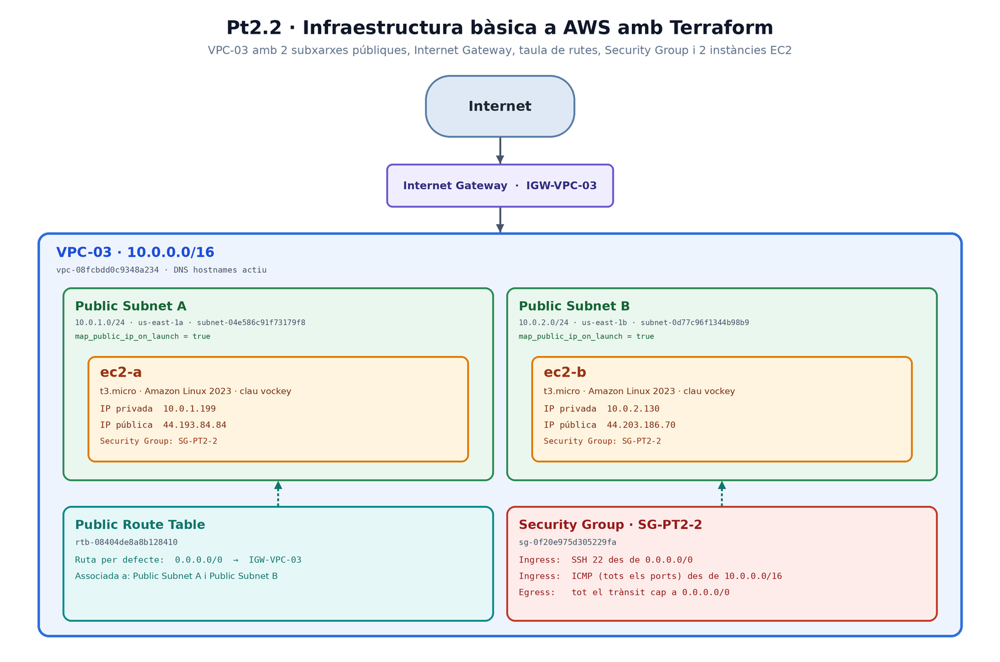
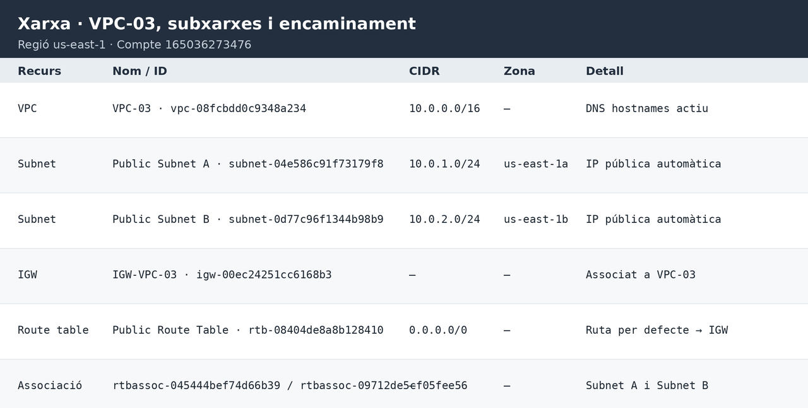
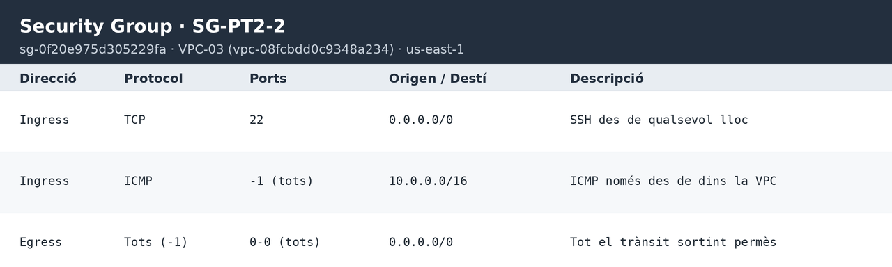
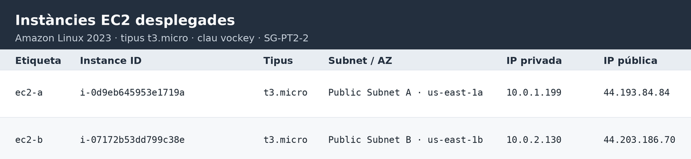
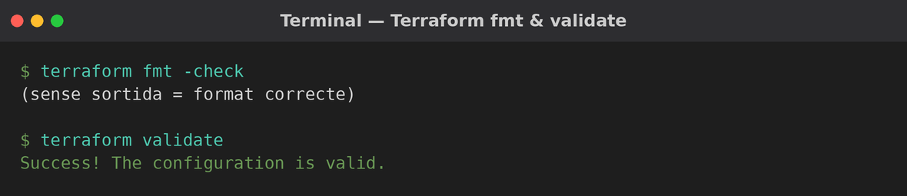
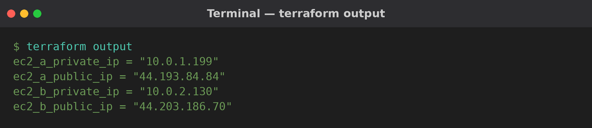
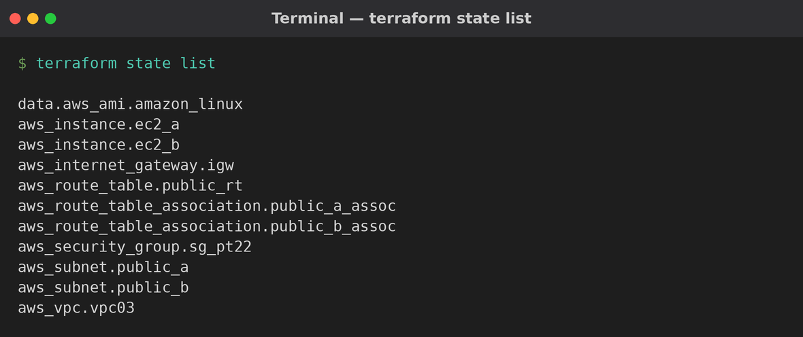

# Pt2.2 · Infraestructura bàsica a AWS amb Terraform

**Grup:** ASIX2 · **Mòdul:** OPT Cloud Computing · **INS Provençana**

## 1. Objectiu

Desplegar amb **Terraform** una infraestructura bàsica a AWS (`us-east-1`) formada per una VPC, dues subxarxes públiques en zones de disponibilitat diferents, un Internet Gateway, una taula de rutes pública, un grup de seguretat i dues instàncies EC2.

Tot el codi és al fitxer [`main.tf`](main.tf).

## 2. Requisits de la pràctica i com es cobreixen

| # | Requisit | Recurs Terraform | Valor |
|---|----------|------------------|-------|
| 1 | Proveïdor AWS a `us-east-1` | `provider "aws"` | `region = "us-east-1"` |
| 2 | VPC anomenada `VPC-03`, `10.0.0.0/16` | `aws_vpc.vpc03` | `cidr_block = "10.0.0.0/16"` |
| 3 | 2 subxarxes públiques amb IP pública automàtica | `aws_subnet.public_a` / `public_b` | `map_public_ip_on_launch = true` |
| 3.a | `Public Subnet A` a `us-east-1a`, `10.0.1.0/24` | `aws_subnet.public_a` | ✅ |
| 3.b | `Public Subnet B` a `us-east-1b`, `10.0.2.0/24` | `aws_subnet.public_b` | ✅ |
| 4.a | Internet Gateway associat a la VPC | `aws_internet_gateway.igw` | `vpc_id = aws_vpc.vpc03.id` |
| 4.b | Taula de rutes amb ruta per defecte cap a l'IGW | `aws_route_table.public_rt` | `0.0.0.0/0 → igw` |
| 4.c | Taula associada a les dues subxarxes | `aws_route_table_association.public_a_assoc` / `public_b_assoc` | ✅ |
| 5.i | SSH permès des de qualsevol lloc | `ingress` del `aws_security_group.sg_pt22` | TCP 22 · `0.0.0.0/0` |
| 5.ii | ICMP només des de dins la VPC | `ingress` del `aws_security_group.sg_pt22` | ICMP · `10.0.0.0/16` |
| 5.iii | Tot el trànsit sortint permès | `egress` del `aws_security_group.sg_pt22` | Tots els protocols · `0.0.0.0/0` |
| 6.a | 2 instàncies `t3.micro` amb Amazon Linux | `aws_instance.ec2_a` / `ec2_b` | `data.aws_ami.amazon_linux` (AL2023) |
| 6.b | Cada instància en una subxarxa diferent | `subnet_id` | `public_a` / `public_b` |
| 6.c | Clau `vockey` i el grup de seguretat creat | `key_name` + `vpc_security_group_ids` | ✅ |
| 6.d | Etiquetes `ec2-a` i `ec2-b` | `tags.Name` | ✅ |

## 3. Arquitectura



El fitxer editable de la topologia és [`assets/topologia.drawio`](assets/topologia.drawio).

## 4. Recursos desplegats

### Xarxa: VPC, subxarxes, IGW i taula de rutes



- VPC **VPC-03** `10.0.0.0/16` → `vpc-08fcbdd0c9348a234`
- **Public Subnet A** `10.0.1.0/24` a `us-east-1a` → `subnet-04e586c91f73179f8`
- **Public Subnet B** `10.0.2.0/24` a `us-east-1b` → `subnet-0d77c96f1344b98b9`
- **Internet Gateway** → `igw-00ec24251cc6168b3`
- **Public Route Table** (`0.0.0.0/0 → IGW`) → `rtb-08404de8a8b128410`, associada a les dues subxarxes

### Grup de seguretat



El grup **SG-PT2-2** (`sg-0f20e975d305229fa`) conté exactament les tres regles demanades: SSH des de `0.0.0.0/0`, ICMP només des de `10.0.0.0/16` i sortida total permesa.

### Instàncies EC2



| Etiqueta | Instance ID | Tipus | Subxarxa / AZ | IP privada | IP pública |
|----------|-------------|-------|---------------|------------|------------|
| `ec2-a` | `i-0d9eb645953e1719a` | `t3.micro` | Public Subnet A · `us-east-1a` | `10.0.1.199` | `44.193.84.84` |
| `ec2-b` | `i-07172b53dd799c38e` | `t3.micro` | Public Subnet B · `us-east-1b` | `10.0.2.130` | `44.203.186.70` |

## 5. Desplegament

```bash
terraform init
terraform fmt -check
terraform validate
terraform plan
terraform apply
```



En acabar, Terraform mostra les IPs de les instàncies:



I es pot comprovar que s'han creat tots els recursos:



## 6. Comprovació del funcionament

Amb les regles del grup de seguretat configurades, el comportament esperat és:

| Prova | Comanda | Resultat |
|-------|---------|----------|
| SSH des de fora | `ssh -i vockey.pem ec2-user@44.193.84.84` | ✅ Permès (TCP 22 des de `0.0.0.0/0`) |
| Ping entre instàncies | `ping -c 4 10.0.2.130` (des de `ec2-a`) | ✅ Permès (origen dins `10.0.0.0/16`) |
| Sortida a Internet | `ping -c 4 8.8.8.8` | ✅ Permès (egress total + IGW) |
| Ping des del PC a l'EC2 | `ping 44.203.186.70` | ❌ Bloquejat (ICMP només des de la VPC) |

La clau privada `vockey.pem` es pot obtenir des del Learner Lab d'AWS Academy i s'utilitza amb l'usuari `ec2-user` d'Amazon Linux.

## 7. Neteja

```bash
terraform destroy
```

## 8. Conclusions

Amb Terraform tota la infraestructura queda definida com a codi, versionada a GitHub i reproduïble amb una sola comanda. El grup de seguretat permet l'SSH des de qualsevol lloc però limita l'ICMP a l'interior de la VPC, i l'ús de dues zones de disponibilitat aporta més tolerància a errors.
